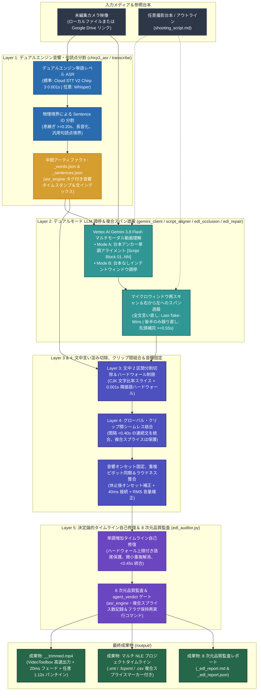

# Video Trimmer (`video-trimmer`)

[](https://github.com/sylphlin/video-trimmer/blob/main/LICENSE)
[](https://www.python.org/)
[]()
[](https://ffmpeg.org/)

[English (en)](README.md) | [繁體中文 (zh-TW)](README.zh-TW.md) | [简体中文 (zh-CN)](README.zh-CN.md) | [日本語 (ja)](README.ja.md) | [한국어 (ko)](README.ko.md)

---

## 概要 (Overview)

**Video Trimmer** は、トーク動画、チュートリアル、プレゼンテーション録画向けの AI 自動ラフカット＆トリミングエンジンです。**Google Vertex AI Gemini 3.8 Flash** のマルチモーダル動画推論、**デュアルエンジン単語レベル音響グラウンドトゥルース**（デフォルトは Google Cloud Speech-to-Text V2 **Chirp 3** `0.001s` ミリ秒精度、オプションでローカル **Whisper** `mlx-whisper` / `faster-whisper`）、**最終テイク基準の複合サブスパン結合（Last-Take-Anchored Composite Sub-Spans）**、**5 レイヤー統合アーキテクチャ**、および **音響オンセット・スナッピング** を組み合わせ、NG テイクや文中の言い淀み、無音区間を除去しながら部分的なピックアップ録音の先頭補完も行い、NLE タイムライン（`.xml`, `.fcpxml`, `.csv`）、8 次元品質監査レポート（`.md`, `.json`）、および MP4 動画を出力します。

---

## 5 レイヤー統合アーキテクチャと主な機能



1. **レイヤー 1：デュアルエンジン単語レベル音響・句読点分割 (`chirp3_asr.py` / `transcribe.py`)**：
   - **標準クラウドエンジン (`--asr-engine chirp3`)**：Google Cloud Speech-to-Text V2 `chirp_3`（`STT_LOCATION=us`、`enableWordTimeOffsets=True`、自動句読点有効）により `0.001s` 精度の単語タイムスタンプを抽出し、18 分チャンク分割（5 秒オーバーラップ）に対応します。認証・権限エラー時は即座に Fail-Fast で終了し、Whisper への暗黙的なフォールバックは行いません。
   - **任意ローカルエンジン (`--asr-engine whisper`)**：ユーザーが明示的にローカル転写を指定した場合のみ、`mlx-whisper` または `faster-whisper` を使用します。
   - 息継ぎ休止（`gap >= 0.20s` および CJK 複数文字トークン間の呼吸休止 `>= 0.35s`）、長音化（`word_dur >= 1.20s`）、句読点、話者交替のみで `Sentence ID` を分割し、Python 側の文字列類似度によるリテイク推測は一切行いません。
2. **レイヤー 2：デュアルモード LLM テイク選定、隣接短節の自動補完＆閉ループ微細ウィンドウ修復 (`gemini_client.py` / `script_aligner.py` / `edl_occlusion.py` / `edl_repair.py`)**：
   - **構造化スキーマ制約 (`EDL_RESPONSE_SCHEMA`)**：各クリップに連続した物理 `Sentence ID` 範囲を強制し、`transcript` に含まれている未選択の先頭・末尾短節を自動補完（`edl_occlusion.py` の `_extend_omitted_adjacent_short_clauses`）します。
   - **Mode A：スクリプトアンカー単調アライメント（台本指定時）**：SSOT パーサー（`script_aligner.py` の `extract_script_blocks`）で非発話見出しを除外して `[Script Block 01] .. [Script Block NN]` に整形し、文頭からの言い直しには 100% `Last-Take-Wins` を適用します。
   - **Mode B：台本なしインテントウィンドウ調停（台本省略時）**：途中放棄された断片を除去しつつ、意図的な反復強調表現を保護します。
   - **右から左へのスパン遮蔽 (`edl_occlusion.py` の `resolve_composite_prefix_occlusions`)**：後半のみを録り直したピックアップテイク（`Take 1: A + B1 + C_ng`、`Take 2: B2 + C_ok`）では、最新の `Take 2`（`composite_role="continuation"`）を基準とし、最小独立節条件（`is_viable_sub_span`、長さ `>= 0.55s`）を満たす未遮蔽の先頭部分 `A`（`composite_role="prefix"`）のみを `Take 1` から補完します。
   - **アライメント後閉ループ検証＆局所マイクロウィンドウ再スキャン (`edl_repair.py`)**：GCS 上の一時動画を削除する前に物理単語アライメント結果（`asr_transcript`）を閉ループ検証し、欠落ブロック、部分一致ブロック（`PARTIAL_SCRIPT_BLOCK_BACKFILL`）、台本フレーズの重複残存（`SCRIPT_PHRASE_MULTIPLICITY`、正当な台本内反復のホワイトリスト対応）、台本外の不要語残存（`UNSCRIPTED_EXTRANEOUS_SPAN`）、末尾・先頭リテイク（`TAIL_HEAD_RETAKE`）、クリップ内反復（`INTRA_CLIP_REPEAT`）、複数テイク衝突（`SCRIPT_TAKE_COLLISION`）を検出して、該当する `15s–90s` 区間のみを `VideoMetadata` で再スキャンします。
3. **レイヤー 3：文中言い淀みの 2 区間切除、CJK 文字比率スライス＆ハードウォール制限 (`transcribe.py`)**：
   - 文中の言い淀み（`[A + B_ng + B_ok + C]`）を `[A]` と `[B_ok + C]` の 2 つのクリーンなサブユニットに分割（`_extract_matched_word_spans_by_transcript`）し、CJK 複数文字トークンの比率補間（`_slice_words_on_char_span`）と隣接未採用語から `0.001s` 手前で止めるハードウォール制限（`next_word_hard_wall` / `prev_word_hard_wall`）を適用します。
4. **レイヤー 4：グローバル・クリップ間結合 (`coalesce_adjacent_sub_units`)**：
   - 単語間ギャップが `< 0.40s` の連続する `Sentence ID` を自動統合しつつ、意図的な複合ピックアップ接続点（`is_composite_splice`）は維持します。
5. **レイヤー 5：決定論的タイムライン自己修復＆ 8 次元品質監査 (`edl_auditor.py`)**：
   - 時系列の単調増加、ハードウォール上限付きの語尾保護（`source_out >= t_last`）、`< 0.45s` マイクロクリップ統合を行い、`asr_engine`・`1_acoustic_lock`・`composite_splices_count`・`agent_verdict` を含む監査レポート（`_edl_report.md` / `_edl_report.json`）を出力します。
6. **音響オンセット固定、重複ピボット同期、20 ms マイクロフェード＆任意 1.12x パンチイン (`acoustic.py` / `render.py`)**：
   - 休止後の膨張した語頭タイムスタンプ補正（`clamp_post_pause_word_onset`）、重複フレーズ内の最小 RMS エネルギー谷での切替同期（`find_optimal_overlap_pivot`）、ラウドネス整合（`compute_composite_gain_db`）、Apple Silicon `VideoToolbox` 高速出力、20 ms 等パワーマイクロフェード、および任意の `--punch-in-composite`（複合継続クリップへの `1.12x` 偶数ピクセルズーム）を実行します。
7. **Agent Plugins 1.0 準拠構造とマルチ NLE タイムライン出力 (`exporters.py`)**：
   - コアスクリプト（`chirp3_asr.py` を含む）とプロンプトは `skills/video-trimmer/` 配下（SSOT）に配置され、`Composite Splice (Pick-up)` タイムライン `<marker>` 付きの **FCP7 XML**、**FCPXML v1.9**、**CSV** を出力します（全 152 件のオフライン単体テスト合格）。

---

## Cloud STT V2 Chirp 3 を標準音響エンジンに採用した理由

動画のラフカットや複合ピックアップ結合（Composite Pick-up Splicing）には、字幕表示用の大まかな時間ではなく、ミリ秒単位の物理的な単語境界が必要です。**Video Trimmer** が標準エンジンをローカル Whisper から Google Cloud Speech-to-Text V2 `chirp_3`（`--asr-engine chirp3`）へ切り替え、Whisper（`--asr-engine whisper`）をオフライン用オプションとして残している技術的理由は以下の 5 点です。

| 評価項目 | Cloud STT V2 `chirp_3`（標準エンジン） | ローカル Whisper（`mlx-whisper` / `faster-whisper`、任意） | ラフカット＆複合結合への影響 |
| :--- | :--- | :--- | :--- |
| **休止後の語頭オンセット精度** | 音響フレーム基準で `0.001s`（`1 ms`）精度の単語オフセットを出力し、実際の発声開始点に密着します。 | Cross-Attention DTW アライメントの特性上、直前の無音や息継ぎ（`0.3s–1.5s+`）を語頭の `start` 時刻に吸収しがちです。 | カット直前の不要な無音を防ぎ、`40ms` の複合ピックアップ接続を自然に保ちます。 |
| **言い淀み・リテイクの逐語保持** | 言い直しや途切れた語、連続するリテイクを欠落なく保持し、単調増加する単語タイムスタンプを維持します。 | 自己回帰デコードにより短い言い淀みの省略、無音区間での幻覚ループ、反復フレーズでの時刻崩壊（`start == end`）が起きることがあります。 | レイヤー 3 の `next_word_hard_wall` が NG 語の境界を正確に固定し、文中の言い淀みを残響なしで切除できます。 |
| **多言語・英語専門用語の認識精度** | 日本語・中国語などの発話内に混在する英語略語（`API`、`SDK`、`GPU` など）を 1 パスで正確に認識します。 | 軽量ローカルモデル（`small` など）では、混在する英単語が誤変換または欠落しやすくなります。 | Mode A の台本カバレッジ算出（`_script_block_coverage_score`）および重複フレーズのピボット同期精度が向上します。 |
| **自動句読点の安定性** | `enableAutomaticPunctuation=True` により、18 分チャンク全体で安定した句読点を付与します。 | プロンプト条件や背景ノイズによって句読点の有無が変動しやすくなります。 | レイヤー 1 の `Sentence ID` 分割が安定し、文の過剰結合や細分化を防ぎます。 |
| **ローカル負荷と長尺動画の処理性能** | 軽量な 16 kHz モノラル MP3 チャンクをクラウドで並列処理し、ローカルのモデル重みや VRAM 消費はゼロです。 | 数百 MB〜数 GB のモデル重みが必要で、FFmpeg `VideoToolbox` と統合メモリを共有します。 | ローカル GPU を高速シークと動画レンダリングに専念させつつ、オフライン環境では `--asr-engine whisper` を利用できます。 |

---

## セットアップと Google Cloud 構成

```bash
# 1. FFmpeg のインストールと Agent Plugin としてのクローン（推奨）
brew install ffmpeg
git clone https://github.com/sylphlin/video-trimmer.git ~/.gemini/config/plugins/video-trimmer

# （オプション）従来の単一 Skill ディレクトリへのインストール（~/.gemini/config/skills/ 互換）
ln -s ~/.gemini/config/plugins/video-trimmer/skills/video-trimmer ~/.gemini/config/skills/video-trimmer

# コア Python 依存パッケージのインストール（標準のクラウド Chirp 3 + Vertex AI 用）
pip install -r ~/.gemini/config/plugins/video-trimmer/requirements.txt

# （オプション）ローカル Whisper バックエンド（--asr-engine whisper 指定時のみ）
pip install mlx-whisper

# 2. ADC 認証と setup.sh の実行（Vertex AI、Cloud STT V2 Chirp 3、GCS を自動構成）
gcloud auth application-default login
cd ~/.gemini/config/plugins/video-trimmer
chmod +x setup.sh
./setup.sh --project YOUR_GCP_PROJECT_ID --region us-central1
```

---

## Antigravity での操作方法と利用シナリオ (Usage & Scenarios)

Antigravity では、以下の 2 つの方法で **Video Trimmer** を操作できます。

1. **簡潔なコマンド指定（`/` でスキル選択 + `@` でファイル指定、推奨）**：`/video-trimmer` を入力してプラグインを選択し、`@` でファイルを添付します。`動画: @XX, 台本: @YY` のように主要項目だけを指定すれば、文章を書く必要はありません。
2. **自然言語プロンプト（自動ルーティング）**：日常の言葉で編集内容を指示すると、Antigravity が自動的にこのプラグインを選択して実行します。

デフォルトではクラウド **Chirp 3**（`--asr-engine chirp3`）を使用し、すべての成果物は入力動画の親ディレクトリ配下の `output/` サブディレクトリ（Google Drive リンクの場合は `./output/`）に保存されます。ローカル Whisper を使用する場合は `ASR: whisper`、複合ピックアップ接続に `1.12x` ズームを適用する場合は `--punch-in-composite` を指定できます。

### シナリオ 1：台本・構成案に基づく動画ラフカット（Mode A：台本アンカーアライメント）
撮影台本や原稿がある録画に最適です。非発話見出しを自動除外し、全文言い直しでは最終テイク（`Last-Take-Wins`）を採用し、後半のみのピックアップ録音では前のテイクから先頭部分を自動補完します。

- **簡潔な `/ + @` コマンド**：
  ```text
  /video-trimmer 動画: @raw_footage.mp4, 台本: @shooting_script.md
  ```
- **自然言語プロンプト**：
  ```text
  @shooting_script.md の台本に沿って @raw_footage.mp4 をトリミングし、言い淀みやリテイクをカットしてください。
  ```

### シナリオ 2：台本なしのフリートーク・インタビュー・Vlog のラフカット（Mode B：台本なし自動重複排除）
台本のない録画に最適です。途中で言い直した未完成の断片、文中の言い淀み、無音区間を自動除去しつつ、意図的な反復強調表現は維持します。

- **簡潔な `/ + @` コマンド**：
  ```text
  /video-trimmer 動画: @raw_footage.mp4
  ```
- **自然言語プロンプト**：
  ```text
  @raw_footage.mp4 の言い間違い、言葉詰まり、無音区間をカットして、NLE タイムラインとラフカット動画を出力してください。
  ```

### シナリオ 3：テンポの速いチュートリアル・解説動画のラフカット（コンパクト・ペーシング）
文間の息継ぎポーズを短縮したい高密度な解説動画に最適です。

- **簡潔な `/ + @` コマンド**：
  ```text
  /video-trimmer 動画: @raw_footage.mp4, 台本: @shooting_script.md, テンポ: コンパクト
  ```
- **自然言語プロンプト**：
  ```text
  @shooting_script.md に照らし合わせて、コンパクトなテンポで @raw_footage.mp4 をラフカットしてください。
  ```

### シナリオ 4：Google Drive 共有リンクからの直接ラフカット
大容量の動画ファイルを手動でダウンロードすることなく、Google Drive の共有リンクを直接渡してラフカットを実行できます。

- **簡潔な `/ + @` コマンド**：
  ```text
  /video-trimmer 動画: https://drive.google.com/file/d/YOUR_FILE_ID/view, 台本: @shooting_script.md
  ```
- **自然言語プロンプト**：
  ```text
  この Google Drive リンクの動画をダウンロードし、@shooting_script.md に沿ってラフカットしてください：https://drive.google.com/file/d/YOUR_FILE_ID/view
  ```

---

## Google Drive 連携と GCS 2 階層ライフサイクルポリシー

| GCS パス接頭辞 (`matchesPrefix`) | 保存対象 | 保持期間 (`age`) | 目的 |
| :--- | :--- | :--- | :--- |
| **`raw/`** | 一時ステージング動画 (`raw/<filename>.mp4`) および Chirp 3 音声チャンク (`raw/chirp3_asr_*/`) | **2 日間 (`age: 2`)** | 推論・転写完了後に `finally` ブロックで即時削除され、バックアップとして 2 日後に自動削除されます。 |
| **`output/`**、**`deliverables/`**、**`trimmed/`** | トリミング済み動画、XML/FCPXML タイムライン | **15 日間 (`age: 15`)** | チーム確認用に 15 日間保持した後、自動削除します。 |

---

## ライセンス (License)

本プロジェクトは [MIT License](LICENSE) の下で提供されています。
