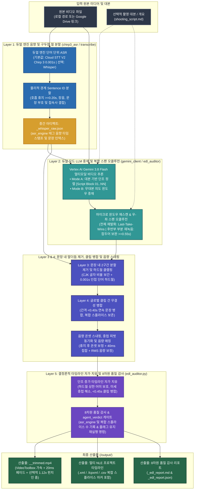

# Video Trimmer (`video-trimmer`)

[](https://github.com/sylphlin/video-trimmer/blob/main/LICENSE)
[](https://www.python.org/)
[]()
[](https://ffmpeg.org/)

[English (en)](README.md) | [繁體中文 (zh-TW)](README.zh-TW.md) | [简体中文 (zh-CN)](README.zh-CN.md) | [日本語 (ja)](README.ja.md) | [한국어 (ko)](README.ko.md)

---

## 개요 (Overview)

**Video Trimmer**는 토킹헤드 비디오, 튜토리얼 및 발표 녹화물을 위한 AI 자동 러프컷 및 트리밍 엔진입니다. **Google Vertex AI Gemini 3.8 Flash** 멀티모달 비디오 추론, **듀얼 엔진 단어 단위 음향 타임스탬프**(기본값: Google Cloud Speech-to-Text V2 **Chirp 3** `0.001s` 정밀도 / 선택 사항: 로컬 **Whisper** `mlx-whisper` / `faster-whisper`), **마지막 테이크 기준 복합 서브스팬 접합(Last-Take-Anchored Composite Sub-Spans)**, **5계층 통합 아키텍처(5-Layer Unified Architecture)** 및 **음향 온셋 스내핑(Acoustic Onset Snapping)**을 결합하여 NG 테이크, 문장 중간 말더듬, 무음 구간을 제거하고 부분 재녹음 시 앞부분을 자동으로 보완한 뒤 NLE 타임라인(`.xml`, `.fcpxml`, `.csv`), 8차원 품질 감사 보고서(`.md`, `.json`) 및 렌더링된 MP4 비디오를 생성합니다.

---

## 5계층 통합 아키텍처 및 핵심 기능



1. **계층 1: 듀얼 엔진 단어 단위 음향 및 구두점 절 분할 (`chirp3_asr.py` / `transcribe.py`)**:
   - **기본 클라우드 엔진 (`--asr-engine chirp3`)**: Google Cloud Speech-to-Text V2 `chirp_3`(`STT_LOCATION=us`, `enableWordTimeOffsets=True`, 자동 구두점 활성화)를 사용하여 `0.001s` 정밀도의 단어 타임스탬프를 추출하며 18분 청크 분할(5초 오버랩)을 지원합니다. 클라우드 인증 및 권한 오류 시 Whisper로 암묵적 폴백 없이 즉시 Fail-Fast로 종료합니다.
   - **선택적 로컬 엔진 (`--asr-engine whisper`)**: 사용자가 로컬 전사를 명시적으로 요청한 경우 `mlx-whisper` 또는 `faster-whisper`를 지원합니다.
   - 호흡 휴지(`gap >= 0.20s` 및 CJK 다자간 호흡 휴지 `>= 0.35s`), 발화 지연 장음(`word_dur >= 1.20s`), 문장 부호 종결, 화자 교체의 물리적 경계만으로 `Sentence ID`를 분할하며 Python 문자열 유사도 추측을 배제합니다.
2. **계층 2: 듀얼 모드 LLM 테이크 중재 및 복합 서브스팬 접합 (`gemini_client.py` / `edl_auditor.py`)**:
   - **Mode A: 대본 기반 단조 정렬 (촬영 대본 제공 시)**: SSOT 파서(`extract_script_blocks`)로 비발화 메타데이터 헤더를 제외하고 `[Script Block 01] .. [Script Block NN]`으로 구성하며, 문장 처음부터 다시 말한 경우 100% `Last-Take-Wins`를 적용합니다.
   - **Mode B: 무대본 의도 윈도우 중재 (대본 미제공 시)**: 미완성 조각(Abandoned Fragment)은 제거하고 의도적인 수사적 반복 강조는 보존합니다.
   - **우-좌 스팬 오클루전 (`resolve_composite_prefix_occlusions`)**: 후반부만 다시 녹음한 부분 픽업 테이크(`Take 1: A + B1 + C_ng`, `Take 2: B2 + C_ok`)에서는 최신 `Take 2`(`composite_role="continuation"`)를 기준으로 삼고, 최소 독립 절 조건(`is_viable_sub_span`, 길이 `>= 0.55s`)을 충족하는 앞부분 `A`(`composite_role="prefix"`)만 `Take 1`에서 보완합니다.
   - **국소 마이크로 윈도우 재스캔 (`edl_auditor.py`)**: 누락 블록, 접두어 보완이 필요한 부분 일치 블록(`PARTIAL_SCRIPT_BLOCK_BACKFILL`), 꼬리-머리 리테이크(`TAIL_HEAD_RETAKE`), 클립 내 반복(`INTRA_CLIP_REPEAT`), 다중 테이크 충돌(`SCRIPT_TAKE_COLLISION`)을 감지하여 해당 `15s–90s` 구간만 `VideoMetadata`로 재스캔합니다.
3. **계층 3: 문장 내 말더듬 2구간 제거, CJK 비율 보간 및 하드월 클램핑 (`transcribe.py`)**:
   - 문장 중간 말더듬(`[A + B_ng + B_ok + C]`)을 `[A]`와 `[B_ok + C]` 두 개의 깔끔한 서브 유닛으로 분할(`_extract_matched_word_spans_by_transcript`)하고, CJK 다자 토큰 비율 보간(`_slice_words_on_char_span`) 및 인접 미선택 단어 `0.001s` 전 하드월 제한(`next_word_hard_wall` / `prev_word_hard_wall`)을 적용합니다.
4. **계층 4: 글로벌 클립 간 무결성 병합 (`coalesce_adjacent_sub_units`)**:
   - 단어 간격이 `< 0.40s`인 연속 `Sentence ID`를 자동 병합하면서 의도적인 복합 픽업 접합점(`is_composite_splice`)은 유지합니다.
5. **계층 5: 결정론적 타임라인 자가 치유 및 8차원 품질 감사 (`edl_auditor.py`)**:
   - 시간순 단조 증가, 하드월 상한 어미 보호(`source_out >= t_last`), `< 0.45s` 마이크로 클립 병합을 수행하고 `asr_engine`, `composite_splices_count`, `agent_verdict` 품질 게이트가 포함된 감사 보고서(`_edl_report.md` / `_edl_report.json`)를 생성합니다.
6. **음향 온셋 스내핑, 중첩 피벗 동기화, 20 ms 마이크로 페이드 및 선택적 1.12x 펀치인 (`acoustic.py` / `render.py`)**:
   - 휴지 후 부풀려진 단어 시작점 보정(`clamp_post_pause_word_onset`), 중첩 구간의 최소 RMS 에너지 지점 피벗 동기화(`find_optimal_overlap_pivot`), 음량 매칭(`compute_composite_gain_db`), Apple Silicon `VideoToolbox` 하드웨어 가속, 20 ms 등전력 마이크로 페이드 및 선택적 `--punch-in-composite`(복합 연속 클립 `1.12x` 짝수 픽셀 줌)를 수행합니다.
7. **Agent Plugins 1.0 표준 아키텍처 및 멀티 NLE 타임라인 지원 (`exporters.py`)**:
   - 핵심 스크립트(`chirp3_asr.py` 포함)와 프롬프트는 `skills/video-trimmer/`(SSOT)에 위치하며, `Composite Splice (Pick-up)` 타임라인 `<marker>`가 포함된 **FCP7 XML**, **FCPXML v1.9** 및 **CSV**를 내보냅니다(총 126개 오프라인 단위 테스트 통과).

---

## Cloud STT V2 Chirp 3를 기본 음향 엔진으로 채택한 이유

비디오 러프컷과 복합 픽업 접합(Composite Pick-up Splicing)에는 자막용 근사 타임스탬프가 아닌 밀리초 단위의 물리적 단어 경계가 필요합니다. **Video Trimmer**가 기본 엔진을 로컬 Whisper에서 Google Cloud Speech-to-Text V2 `chirp_3`(`--asr-engine chirp3`)로 전환하고 Whisper(`--asr-engine whisper`)를 오프라인 선택 옵션으로 유지하는 다섯 가지 기술적 이유는 다음과 같습니다:

| 평가 항목 | Cloud STT V2 `chirp_3` (기본 엔진) | 로컬 Whisper (`mlx-whisper` / `faster-whisper`, 선택) | 러프컷 및 복합 스플라이싱에 미치는 영향 |
| :--- | :--- | :--- | :--- |
| **휴지 후 어두 온셋 정밀도** | 음향 프레임 기준으로 `0.001s`(`1 ms`) 단어 오프셋을 출력하여 실제 발성 시작점에 밀착됩니다. | Cross-Attention DTW 정렬 특성상 앞선 무음이나 호흡(`0.3s–1.5s+`)을 첫 단어의 `start` 시각에 포함하는 경우가 많습니다. | 컷 시작 전 불필요한 무음을 방지하고 `40ms` 복합 픽업 접합면을 매끄럽게 유지합니다. |
| **말더듬 및 리테이크 원문 보존** | 말실수 조각과 연속 재발화 구간을 누락 없이 보존하며 단조 증가하는 타임스탬프를 유지합니다. | 자기회귀 디코딩 과정에서 짧은 말더듬 생략, 무음 구간 환각 루프, 반복 구절 타임스탬프 붕괴(`start == end`)가 발생할 수 있습니다. | 계층 3의 `next_word_hard_wall`이 NG 단어 경계를 정확히 고정하여 문장 내 말더듬을 잔음 없이 제거합니다. |
| **다국어 및 영문 전문 용어 인식** | 한국어·중국어·일본어 발화 내 영문 약어(`API`, `SDK`, `GPU` 등) 코드스위칭을 단일 패스로 정확히 인식합니다. | 경량 로컬 모델(`small` 등)은 혼용된 영문 용어를 오인식하거나 누락하기 쉽습니다. | Mode A 대본 커버리지 계산(`_script_block_coverage_score`)과 중첩 구간 피벗 동기화 정확도를 높입니다. |
| **자동 구두점 안정성** | `enableAutomaticPunctuation=True`를 통해 18분 청크 전반에 걸쳐 일관된 문장 부호를 제공합니다. | 프롬프트 조건이나 배경 소음에 따라 구두점 출력이 흔들릴 수 있습니다. | 계층 1의 `Sentence ID` 물리적 분할을 안정화하여 과도한 병합이나 파편화를 방지합니다. |
| **로컬 리소스 및 장시간 처리량** | 경량 16 kHz 모노 MP3 청크를 클라우드에서 병렬 처리하여 로컬 모델 가중치나 VRAM 점유가 없습니다. | 수백 MB~수 GB 가중치 다운로드가 필요하며 FFmpeg `VideoToolbox`와 통합 메모리를 공유합니다. | 로컬 GPU를 고속 키프레임 탐색과 MP4 렌더링에 집중시키면서 오프라인 환경에서는 `--asr-engine whisper`를 지원합니다. |

---

## 설치 및 Google Cloud 설정

```bash
# 1. FFmpeg 설치 및 Agent Plugin으로 클론 (권장)
brew install ffmpeg
git clone https://github.com/sylphlin/video-trimmer.git ~/.gemini/config/plugins/video-trimmer

# (선택 사항) 기존 단일 Skill 디렉터리 설치 (~/.gemini/config/skills/ 호환 방식)
ln -s ~/.gemini/config/plugins/video-trimmer/skills/video-trimmer ~/.gemini/config/skills/video-trimmer

# 핵심 Python 의존성 설치 (기본 클라우드 Chirp 3 + Vertex AI)
pip install -r ~/.gemini/config/plugins/video-trimmer/requirements.txt

# (선택 사항) 로컬 Whisper 가속 백엔드 설치 (--asr-engine whisper 사용 시)
pip install mlx-whisper

# 2. ADC 인증 및 setup.sh 실행 (Vertex AI, Cloud STT V2 Chirp 3, GCS 자동 구성)
gcloud auth application-default login
cd ~/.gemini/config/plugins/video-trimmer
chmod +x setup.sh
./setup.sh --project YOUR_GCP_PROJECT_ID --region us-central1
```

---

## Antigravity 조작 방법 및 사용 시나리오 (Usage & Scenarios)

Antigravity에서는 다음 두 가지 방식으로 **Video Trimmer**를 사용할 수 있습니다:

1. **간결한 명령어 입력 (`/` 스킬 선택 + `@` 파일 태그, 권장)**: `/video-trimmer`를 입력하여 플러그인을 선택하고 `@`로 파일을 태그합니다. `비디오: @XX, 대본: @YY`처럼 핵심 항목만 지정하면 긴 문장을 작성할 필요가 없습니다.
2. **자연어 프롬프트 (자동 라우팅)**: 일상적인 대화체로 편집 요구 사항을 설명하면 Antigravity가 의도를 파악하여 자동으로 플러그인을 실행합니다.

기본적으로 클라우드 **Chirp 3**(`--asr-engine chirp3`)를 사용하며, 모든 결과물은 원본 비디오 폴더 아래의 `output/` 하위 디렉터리(Google Drive 링크의 경우 `./output/`)에 격리 저장됩니다. 로컬 Whisper 전사가 필요한 경우 `ASR: whisper`를 지정하고, 복합 픽업 컷에 `1.12x` 줌을 적용하려면 `--punch-in-composite`를 사용할 수 있습니다.

### 시나리오 1: 대본/아웃라인 기반 녹화본 러프컷 (Mode A: 대본 단조 정렬)
촬영 대본이나 원고가 준비된 녹화본에 적합합니다. 비발화 제목을 필터링하고 전체 재발화 시 마지막 테이크(`Last-Take-Wins`)를 유지하며, 후반부만 부분 재녹음한 경우 이전 테이크에서 앞부분을 자동 보완합니다.

- **간결한 `/ + @` 명령어**:
  ```text
  /video-trimmer 비디오: @raw_footage.mp4, 대본: @shooting_script.md
  ```
- **자연어 프롬프트**:
  ```text
  @shooting_script.md 대본에 맞춰 @raw_footage.mp4를 트리밍하고 말더듬과 재촬영 구간을 잘라내 주세요.
  ```

### 시나리오 2: 무대본 즉흥 토크, 인터뷰 또는 브이로그 러프컷 (Mode B: 무대본 지능형 중복 제거)
대본 없는 자유 녹화본에 적합합니다. 말하다 중단한 미완성 문장, 문장 중간 말더듬, 무음 구간을 자동으로 제거하면서 의도적인 반복 강조 표현은 보존합니다.

- **간결한 `/ + @` 명령어**:
  ```text
  /video-trimmer 비디오: @raw_footage.mp4
  ```
- **자연어 프롬프트**:
  ```text
  @raw_footage.mp4에서 말실수, 막히는 부분, 중복 시작 구간을 잘라내고 NLE 타임라인과 러프컷 영상을 내보내 주세요.
  ```

### 시나리오 3: 빠른 템포의 튜토리얼 및 쇼트폼 러프컷 (컴팩트 페이싱)
문장 사이의 호흡 휴지를 줄여야 하는 고밀도 튜토리얼이나 해설 영상에 적합합니다.

- **간결한 `/ + @` 명령어**:
  ```text
  /video-trimmer 비디오: @raw_footage.mp4, 대본: @shooting_script.md, 템포: 컴팩트
  ```
- **자연어 프롬프트**:
  ```text
  @shooting_script.md를 기준으로 컴팩트한 템포로 @raw_footage.mp4를 러프컷해 주세요.
  ```

### 시나리오 4: Google Drive 클라우드 비디오 직접 러프컷
대용량 파일을 수동으로 다운로드할 필요 없이 Google Drive 공유 링크를 직접 전달하여 러프컷을 수행합니다.

- **간결한 `/ + @` 명령어**:
  ```text
  /video-trimmer 비디오: https://drive.google.com/file/d/YOUR_FILE_ID/view, 대본: @shooting_script.md
  ```
- **자연어 프롬프트**:
  ```text
  이 Google Drive 링크의 비디오를 다운로드하여 @shooting_script.md에 맞춰 러프컷해 주세요: https://drive.google.com/file/d/YOUR_FILE_ID/view
  ```

---

## Google Drive 연동 및 GCS 2단계 수명 주기 정책

| GCS 경로 접두사 (`matchesPrefix`) | 저장 객체 | 보관 기간 (`age`) | 목적 |
| :--- | :--- | :--- | :--- |
| **`raw/`** | 스테이징된 원본 비디오 (`raw/<filename>.mp4`) 및 Chirp 3 오디오 청크 (`raw/chirp3_asr_*/`) | **2일 (`age: 2`)** | 추론 및 전사 완료 후 `finally` 블록에서 즉시 삭제되며 안전 백업으로 2일 후 자동 삭제됩니다. |
| **`output/`**, **`deliverables/`**, **`trimmed/`** | 트리밍된 비디오, XML/FCPXML 타임라인 | **15일 (`age: 15`)** | 팀 검토를 위해 15일간 보관한 후 자동 삭제합니다. |

---

## 라이선스 (License)

이 프로젝트는 [MIT License](LICENSE)에 따라 라이선스가 부여됩니다.
