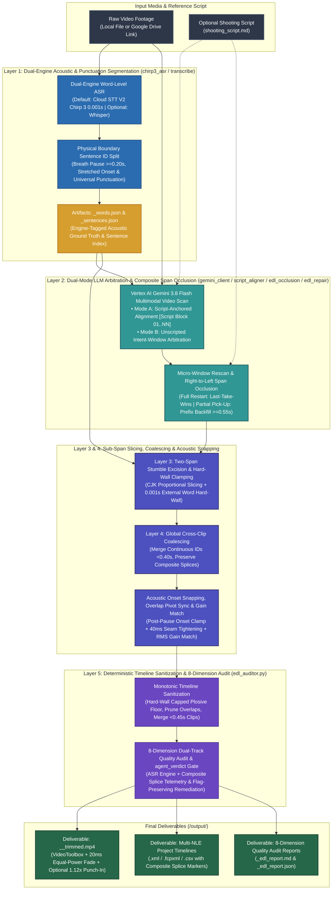

# Video Trimmer (`video-trimmer`)

[](https://github.com/sylphlin/video-trimmer/blob/main/LICENSE)
[](https://www.python.org/)
[]()
[](https://ffmpeg.org/)

[English (en)](README.md) | [繁體中文 (zh-TW)](README.zh-TW.md) | [简体中文 (zh-CN)](README.zh-CN.md) | [日本語 (ja)](README.ja.md) | [한국어 (ko)](README.ko.md)

---

## Overview

**Video Trimmer** is an automated video rough-cut and trimming engine for talking-head recordings, tutorials, and presentations. It combines **Google Vertex AI Gemini 3.8 Flash** multimodal video reasoning with **Dual-Engine Word-Level Acoustic Ground Truth** (Google Cloud Speech-to-Text V2 **Chirp 3** at `0.001 s` precision by default; local **Whisper** via `mlx-whisper` / `faster-whisper` optional), **Last-Take-Anchored Composite Sub-Spans**, a **5-Layer Unified Architecture**, and **Acoustic Onset Snapping**. Each run removes bad takes, mid-sentence stumbles, and dead air while salvaging partial pick-up takes, then exports NLE project timelines (`.xml`, `.fcpxml`, `.csv`), an 8-dimension quality audit report (`.md`, `.json`), and a rendered MP4 video.

---

## 5-Layer Unified Architecture & Core Capabilities



1. **Layer 1 — Dual-Engine Word-Level Acoustic & Punctuation Segmentation (`chirp3_asr.py` / `transcribe.py`)**:
   - **Default Engine (`--asr-engine chirp3`)**: Uses Google Cloud Speech-to-Text V2 `chirp_3` (`STT_LOCATION=us`, `enableWordTimeOffsets=True`, `enableAutomaticPunctuation=True`) to extract `0.001 s` word timestamps with automatic 18-minute chunking (5-second overlap) and 1-to-1 Simplified-to-Traditional character normalization for `zh-TW`. Enforces strict Fail-Fast on cloud or authentication errors without silent fallback to Whisper.
   - **Optional Local Engine (`--asr-engine whisper`)**: Supports offline transcription via `mlx-whisper` (Apple Silicon Metal) or `faster-whisper` (CPU/CUDA) when requested by the user.
   - Splits `Sentence ID` units strictly on physical and universal punctuation boundaries: breath pauses (`gap >= 0.20 s`, comma-absorbed pauses `>= 0.22 s`, micro-paused clause commas `>= 0.18 s`, and multi-character CJK breath splits `>= 0.35 s`), stretched word onsets (`word_dur >= 1.20 s` and `>= 0.45 s/char`), closure punctuation, and speaker turns, without language-specific conjunction or filler word lists. Python never guesses semantic retakes via string similarity.
2. **Layer 2 — Dual-Mode LLM Take Arbitration, Adjacent Short-Clause Recovery, & Closed-Loop Micro-Window Repair (`gemini_client.py` / `script_aligner.py` / `edl_occlusion.py` / `edl_repair.py`)**:
   - **Structured Schema & Adjacent Short-Clause Auto-Extension**: Enforces `EDL_RESPONSE_SCHEMA` with contiguous physical `Sentence ID` ranges per clip, and auto-extends `sentence_ids` when an unclaimed adjacent opening or closing short clause is explicitly present in `transcript` (`_extend_omitted_adjacent_short_clauses` in `edl_occlusion.py`).
   - **Mode A: Monotonic Script-Anchored Alignment (With Shooting Script)**: Strips YAML frontmatter, stage directions, and metadata headers via `extract_script_blocks` (`script_aligner.py`, `[Script Block 01] .. [Script Block NN]`). Enforces `Last-Take-Wins` when the speaker restarts a block from the beginning.
   - **Mode B: Unscripted Intent-Window Arbitration (Without Script)**: Prunes abandoned fragments and false starts while preserving intentional rhetorical repetition.
   - **Last-Take-Anchored Right-to-Left Span Occlusion (`resolve_composite_prefix_occlusions` in `edl_occlusion.py`)**: When the speaker performs a partial tail pick-up (`Take 1: A + B1 + C_ng`, `Take 2: B2 + C_ok`), anchors on `Take 2` (`composite_role="continuation"`) and backfills only the non-occluded prefix `A` (`composite_role="prefix"`) from `Take 1` if `A` meets the script-neutral viability threshold (`is_viable_sub_span`, duration `>= 0.55 s`).
   - **Closed-Loop Post-Alignment Verification & Micro-Window Repair (`edl_repair.py`)**: Verifies physical word-aligned `asr_transcript` before deleting staged GCS media. Detects missing blocks, partial block coverage (`PARTIAL_SCRIPT_BLOCK_BACKFILL`), duplicate script clauses (`SCRIPT_PHRASE_MULTIPLICITY` with legitimate script repetition whitelisting), unscripted extraneous spans (`UNSCRIPTED_EXTRANEOUS_SPAN`), tail-to-head retakes (`TAIL_HEAD_RETAKE`), intra-clip repeats (`INTRA_CLIP_REPEAT`), and multi-take collisions (`SCRIPT_TAKE_COLLISION`), then re-scans only the affected `15 s–90 s` video slice via Vertex AI `VideoMetadata`.
3. **Layer 3 — Two-Span Stumble Excision, CJK Proportional Slicing, & Hard-Wall Clamping (`transcribe.py`)**:
   - Supports **Intra-Sentence Mid-Span Excision** (`_extract_matched_word_spans_by_transcript`), splitting `[A + B_ng + B_ok + C]` into clean sub-units `[A]` and `[B_ok + C]` around mid-sentence stumbles.
   - Interpolates multi-character CJK word tokens proportionally (`_slice_words_on_char_span`) and clamps internal cuts `0.001 s` away from adjacent unselected words (`next_word_hard_wall` / `prev_word_hard_wall`) to prevent ghost syllables.
4. **Layer 4 — Global Cross-Clip Coalescing (`coalesce_adjacent_sub_units`)**:
   - Merges consecutive `Sentence ID`s across adjacent clips when the physical inter-word gap is `< 0.40 s`, while preserving intentional composite pick-up splices (`is_composite_splice`).
5. **Layer 5 — Deterministic Timeline Sanitization & 8-Dimension Quality Audit (`edl_auditor.py`)**:
   - Enforces chronological monotonicity (`source_in < source_out` and `c[i].source_out <= c[i+1].source_in`), caps plosive-tail restoration at `next_word_hard_wall`, merges `< 0.45 s` flash-frame micro-clips, and generates `_edl_report.md` and `_edl_report.json` with `asr_engine`, `1_acoustic_lock`, `composite_splices_count`, and `agent_verdict`.
6. **Acoustic Onset Snapping, Overlap Pivot Sync, & Loudness Matching (`acoustic.py`)**:
   - Clamps post-pause inflated word onsets (`clamp_post_pause_word_onset`), synchronizes overlapping composite phrase pivots at minimum RMS energy valleys (`find_optimal_overlap_pivot`), tightens composite cut seams (`40 ms` buffers), and matches continuation loudness (`compute_composite_gain_db`, clamped to `±6.0 dB`).
7. **20 ms Equal-Power Micro-Crossfade & Optional 1.12x Composite Punch-In (`render.py`)**:
   - Renders with fast keyframe seeking (`-ss`/`-to`), Apple Silicon `VideoToolbox` hardware acceleration (`libx264` fallback), 20 ms equal-power micro-fades (`iqsin`/`qsin`), per-clip loudness gain filters, and optional `--punch-in-composite` (`1.12x` even-pixel crop zoom on pick-up continuations to mask visual jump-cuts).
8. **Multi-NLE Timeline Interoperability with Composite Markers (`exporters.py`)**:
   - Exports frame-accurate **FCP7 XML** (`.xml`), **Apple FCPXML v1.9** (`.fcpxml`), and **CSV** cut lists, embedding `Composite Splice (Pick-up)` timeline `<marker>` annotations and optional `112%` transform metadata.

---

## Why Cloud STT V2 Chirp 3 Is the Default Acoustic Engine

Video rough-cutting and composite pick-up splicing require physical millisecond word boundaries rather than approximate subtitle-level alignment. **Video Trimmer** defaults to Google Cloud Speech-to-Text V2 `chirp_3` (`--asr-engine chirp3`) and keeps local Whisper (`--asr-engine whisper`) as an optional offline engine for five engineering reasons:

| Dimension | Cloud STT V2 `chirp_3` (Default) | Local Whisper (`mlx-whisper` / `faster-whisper`, Optional) | Impact on Rough-Cut & Composite Splicing |
| :--- | :--- | :--- | :--- |
| **Post-Pause Word Onset Precision** | Acoustic-frame-grounded `0.001 s` (`1 ms`) word offsets lock directly to vocal onset. | Cross-attention DTW alignment often absorbs `0.3 s–1.5 s+` of preceding silence or breath into a word's `start` time. | Prevents dead air before cuts and keeps `40 ms` composite pick-up seams tight. |
| **Verbatim Stumble & Retake Preservation** | Preserves false starts, partial words, and back-to-back retakes with monotonic word timestamps. | Autoregressive decoding can skip short stumbles, hallucinate in silence, or collapse timestamps (`start == end`) on repeated phrases. | Ensures Layer 3 (`next_word_hard_wall`) can isolate and excise mid-sentence NG words without ghost syllables. |
| **Multilingual & Code-Switching Fidelity** | Recognizes mixed CJK and English technical terms (`API`, `SDK`, `GPU`) accurately in a single pass. | Compact local models (`small`) often transliterate or drop embedded English terms inside CJK speech. | Improves Mode A script-block coverage scoring and composite overlap pivot matching. |
| **Automatic Punctuation Stability** | Native `enableAutomaticPunctuation=True` delivers consistent clause punctuation across 18-minute slices. | Punctuation output fluctuates with prompt conditioning and acoustic noise. | Stabilizes Layer 1 `Sentence ID` splitting without over-merging or fragmenting clauses. |
| **Local Resource Footprint** | Stages lightweight 16 kHz mono MP3 slices to GCS with zero local model weights or VRAM contention. | Downloads multi-hundred-MB/GB weights and shares GPU/unified memory with FFmpeg `VideoToolbox`. | Keeps local hardware dedicated to fast keyframe seeking and MP4 rendering; Whisper remains available for offline use. |

---

## Project Structure (Agent Plugins 1.0 Specification)

```text
video-trimmer/
├── plugin.json                              # Agent Plugins 1.0 manifest
├── rules/
│   └── AGENTS.md                            # Packaged client execution invariants (read-only & fail-fast)
├── skills/
│   └── video-trimmer/                       # Canonical Skill Bundle (Single Source of Truth)
│       ├── SKILL.md                         # Agent Skill specification & CLI options reference for AI agents
│       ├── scripts/                         # Canonical core engine modules (SSOT)
│       │   ├── __init__.py
│       │   ├── video_trimmer.py             # CLI parser and 5-layer pipeline orchestrator
│       │   ├── constants.py                 # Named constants & ASR / composite thresholds
│       │   ├── exceptions.py                # Exception hierarchy
│       │   ├── chirp3_asr.py                # Google Cloud STT V2 Chirp 3 word-level ASR (0.001s precision)
│       │   ├── acoustic.py                  # Onset snapping, overlap pivot sync, and RMS gain matching
│       │   ├── transcribe.py                # Dual-engine segmentation, CJK slicing, and two-span excision
│       │   ├── script_aligner.py            # Script block parser, text normalizer, and coverage scorer
│       │   ├── edl_occlusion.py             # Span occlusion, short-clause recovery, and clip deduplication
│       │   ├── edl_repair.py                # Closed-loop anomaly detector and micro-window rescan repair
│       │   ├── edl_auditor.py               # Monotonic timeline sanitizer and 8-dimension quality auditor
│       │   ├── gemini_client.py             # Vertex AI (ADC) client and dual-mode prompt builder
│       │   ├── gcs_utils.py                 # Cloud Storage staging, Google Drive cache, and CJK recovery
│       │   ├── exporters.py                 # FCP7 XML, FCPXML v1.9, and CSV exporters with splice markers
│       │   └── render.py                    # FFmpeg micro-crossfade, gain match, and 1.12x punch-in render
│       └── prompts/                         # Canonical prompt specifications (SSOT)
│           └── video_cut_prompt.md          # Dual-mode take arbitration & composite pick-up prompt
├── AGENTS.md                                # Workspace & engineering development rules (Part I & Part II)
├── README.md                                # English documentation
├── LICENSE                                  # MIT License
├── .env.example                             # Environment variables template for Vertex AI, STT V2, and GCS
├── setup.sh                                 # Native gcloud provisioning script (Zero Terraform)
├── pyproject.toml                           # PEP 621 Python package configuration
├── requirements.txt                         # Python dependencies
└── tests/                                   # Offline unit test suite (152 tests)
```

---

## Installation & Google Cloud Setup

### 1. Install FFmpeg

Install [FFmpeg](https://ffmpeg.org/) and verify that `ffmpeg` and `ffprobe` are in `PATH`:

```bash
# macOS (Homebrew)
brew install ffmpeg

# Ubuntu / Debian
sudo apt update && sudo apt install -y ffmpeg
```

### 2. Install as an Antigravity Plugin

```bash
# Global Plugin (Recommended)
git clone https://github.com/sylphlin/video-trimmer.git ~/.gemini/config/plugins/video-trimmer

# Or Workspace Plugin
git clone https://github.com/sylphlin/video-trimmer.git .agents/plugins/video-trimmer

# Legacy Single-Skill Installation (~/.gemini/config/skills/)
ln -s ~/.gemini/config/plugins/video-trimmer/skills/video-trimmer ~/.gemini/config/skills/video-trimmer

# Install Core Python Dependencies (Cloud Chirp 3 + Vertex AI Default)
pip install -r ~/.gemini/config/plugins/video-trimmer/requirements.txt

# Optional: Install Local Whisper Backend (Apple Silicon Metal, for --asr-engine whisper)
pip install mlx-whisper
```

### 3. Provision Google Cloud Resources (`./setup.sh`)

Run `setup.sh` to enable Vertex AI, Cloud Speech-to-Text V2 (`chirp_3`), and Cloud Storage, and configure Application Default Credentials (ADC) using native `gcloud` commands:

```bash
# Authenticate ADC
gcloud auth application-default login

# Provision APIs, STT V2 & GCS IAM roles, two-tier lifecycle rules (raw: 2d, deliverables: 15d), and .env
cd ~/.gemini/config/plugins/video-trimmer
chmod +x setup.sh
./setup.sh --project YOUR_GCP_PROJECT_ID --region us-central1
```

---

## Antigravity Usage & Scenarios

You can operate **Video Trimmer** in Antigravity using two interaction modes:

1. **Concise `/skill` + `@file` Invocation (Recommended)**: Type `/video-trimmer` to select the plugin and tag your files with `@`. Specify only the key parameters (for example, `Video: @XX, Script: @YY`) without writing full sentences.
2. **Natural Language Prompt (Auto-Routed)**: Describe your editing goal in plain conversational language. Antigravity automatically selects and runs this plugin.

By default, **Video Trimmer** uses Cloud Speech-to-Text V2 `chirp_3` (`--asr-engine chirp3`) and isolates all generated deliverables in the `output/` subdirectory next to the input video (`./output/` for Google Drive links). Pass `ASR: whisper` only when you explicitly want local Whisper transcription, or add `Punch-in: true` (`--punch-in-composite`) to apply a `1.12x` framing zoom on composite pick-up cuts.

### Scenario 1: Script-Guided Recording Rough-Cut (Mode A: Monotonic Script-Anchored Alignment)
Use this scenario when you have a shooting script or outline. The agent strips non-spoken metadata headers, aligns every spoken block in order, enforces `Last-Take-Wins` on full restarts, and automatically backfills missing prefixes on partial pick-up takes.

- **Concise `/ + @` Command**:
  ```text
  /video-trimmer Video: @raw_footage.mp4, Script: @shooting_script.md
  ```
- **Natural Language Prompt**:
  ```text
  Trim @raw_footage.mp4 using @shooting_script.md as the reference script, and remove all stutters and retakes.
  ```

### Scenario 2: Unscripted Talking-Head, Interview, or Vlog Rough-Cut (Mode B: Unscripted Intent-Window Arbitration)
Use this scenario for free-form recordings without a script. The agent removes false starts, mid-sentence stumbles, and dead air while preserving intentional rhetorical repetition.

- **Concise `/ + @` Command**:
  ```text
  /video-trimmer Video: @raw_footage.mp4
  ```
- **Natural Language Prompt**:
  ```text
  Clean up @raw_footage.mp4 by removing bad takes, stutters, and dead air, and export the NLE timelines and rough-cut MP4.
  ```

### Scenario 3: Fast-Paced Tutorial or Explainer Rough-Cut (Compact Pacing)
Use this scenario for high-density tutorials where tighter inter-sentence pauses are desired.

- **Concise `/ + @` Command**:
  ```text
  /video-trimmer Video: @raw_footage.mp4, Script: @shooting_script.md, Pacing: compact
  ```
- **Natural Language Prompt**:
  ```text
  Rough-cut @raw_footage.mp4 with compact pacing against @shooting_script.md.
  ```

### Scenario 4: Direct Rough-Cut from a Google Drive Share Link
Pass a Google Drive URL directly without manually downloading large video files first.

- **Concise `/ + @` Command**:
  ```text
  /video-trimmer Video: https://drive.google.com/file/d/YOUR_FILE_ID/view, Script: @shooting_script.md
  ```
- **Natural Language Prompt**:
  ```text
  Download this Google Drive video and rough-cut it against @shooting_script.md: https://drive.google.com/file/d/YOUR_FILE_ID/view
  ```

---

## Generated Deliverables

For an input video `raw_footage.mp4`, the agent automatically creates an `output/` subdirectory next to the source video and delivers:

1. **`output/raw_footage_<tag>_trimmed.mp4`**: Rendered rough-cut video with 20 ms equal-power audio crossfades and composite loudness matching.
2. **`output/raw_footage_<tag>_edl.xml`**: Final Cut Pro 7 XML timeline for **Adobe Premiere Pro** and **DaVinci Resolve** (with `Composite Splice` markers).
3. **`output/raw_footage_<tag>_edl.fcpxml`**: Apple FCPXML v1.9 timeline for **Final Cut Pro** (with `Composite Splice` markers).
4. **`output/raw_footage_<tag>_edl.json`** & **`_edl.csv`**: Structured decision metadata and spreadsheet cut table with editorial notes.
5. **`output/raw_footage_<tag>_edl_report.md`** & **`_edl_report.json`**: 8-dimension rough-cut quality audit report with `asr_engine`, `1_acoustic_lock`, `composite_splices_count`, and top-level `agent_verdict`.
6. **`output/raw_footage_words.json`** & **`output/raw_footage_sentences.json`**: Engine-tagged (`chirp3` or `whisper`) cached word-level acoustic ground truth and clause-segmented `Sentence ID` candidate index.

---

## Two-Tier GCS Bucket Lifecycle Policy (`gs://video-preprocessing-${PROJECT_ID}`)

| GCS Prefix (`matchesPrefix`) | Stored Objects | Retention (`age`) | Purpose |
| :--- | :--- | :--- | :--- |
| **`raw/`** | Staged raw videos (`raw/<filename>.mp4`) and temporary Chirp 3 audio slices (`raw/chirp3_asr_*/`) | **2 Days (`age: 2`)** | Deletes staged media and ASR chunks immediately in `finally` blocks, with a 2-day bucket rule as a safety backstop. |
| **`output/`**, **`deliverables/`**, **`trimmed/`** | Trimmed videos, XML/FCPXML timelines, and EDL reports | **15 Days (`age: 15`)** | Retains deliverables for 15 days for team review before automatic deletion. |

---

## Unit Testing

Run the offline test suite (152 tests) before committing changes:

```bash
python3 -m unittest discover -s tests -v
```

---

## License

This project is licensed under the [MIT License](LICENSE).
