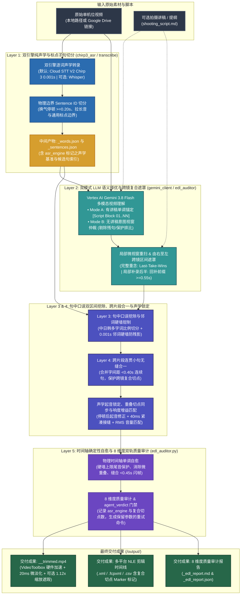

# Video Trimmer (`video-trimmer`)

[](https://github.com/sylphlin/video-trimmer/blob/main/LICENSE)
[](https://www.python.org/)
[]()
[](https://ffmpeg.org/)

[English (en)](README.md) | [繁體中文 (zh-TW)](README.zh-TW.md) | [简体中文 (zh-CN)](README.zh-CN.md) | [日本語 (ja)](README.ja.md) | [한국어 (ko)](README.ko.md)

---

## 项目概览 (Overview)

**Video Trimmer** 是面向口播视频、教程与演讲录像的 AI 自动粗剪引擎。系统结合 **Google Vertex AI Gemini 3.8 Flash** 多模态视频推理、**双引擎毫秒级逐字声学基准**（默认采用 Google Cloud Speech-to-Text V2 **Chirp 3** `0.001s` 精度；可选本地 **Whisper** `mlx-whisper` / `faster-whisper`）、**以最后一镜为基准的跨镜复合拼接（Last-Take-Anchored Composite Sub-Spans）**、**五层统一剪辑架构（5-Layer Unified Architecture）** 与 **声学起音锁定（Acoustic Onset Snapping）**。每次运行会自动剔除 NG 重录、句中口误与静音停顿，并在讲者仅补录后半句时自动回补上一镜的前半句，最后导出专业 NLE 时间线（`.xml`, `.fcpxml`, `.csv`）、8 维度质量审计报告（`.md`, `.json`）及渲染完成的 MP4 视频。

---

## 五层统一剪辑架构与核心技术能力



1. **第一层：双引擎纯声学与标点子句切分 (`chirp3_asr.py` / `transcribe.py`)**：
   - **默认云端引擎 (`--asr-engine chirp3`)**：采用 Google Cloud Speech-to-Text V2 `chirp_3`（`STT_LOCATION=us`，启用 `enableWordTimeOffsets=True` 与自动标点），提取 `0.001s` 毫秒级逐词时间戳，支持 18 分钟长音频自动分块（5 秒重叠窗口）；遇到云端认证或权限错误时严格执行 Fail-Fast 终止，绝不静默降级为 Whisper。
   - **可选本地引擎 (`--asr-engine whisper`)**：在用户明确指定本地转录时，支持 `mlx-whisper`（Apple Silicon Metal）或 `faster-whisper`。
   - 仅依据物理边界切分 `Sentence ID`：换气停顿（`gap >= 0.20s` 及中日韩多字词自然换气 `>= 0.35s`）、吃螺丝拉长音起音（`word_dur >= 1.20s`）、句尾标点与说话人轮替，绝不在 Python 中使用字符串相似度猜测 NG 重录。
2. **第二层：双模式 LLM 语义择优与跨镜复合拼接 (`gemini_client.py` / `edl_auditor.py`)**：
   - **Mode A：有讲稿单调锚定模式（提供拍摄讲稿时）**：通过单一真相来源（SSOT）解析器（`extract_script_blocks`）自动过滤 YAML Frontmatter、舞台指示与非口播元数据行，将口播台词格式化为 `[Script Block 01] .. [Script Block NN]`。整句重念时严格维持 `Last-Take-Wins`。
   - **Mode B：无讲稿意图视窗仲裁模式（未提供讲稿时）**：剔除未完成残句重录（Abandoned Fragment），同时保护刻意修辞排比强调。
   - **由右至左跨镜区间遮罩 (`resolve_composite_prefix_occlusions`)**：当讲者仅局部补录后半句（`Take 1: A + B1 + C_ng`、`Take 2: B2 + C_ok`）时，以最新 `Take 2`（`composite_role="continuation"`）为基准，仅从上一镜 `Take 1` 回补未被覆盖的前缀 `A`（`composite_role="prefix"`，须满足 `is_viable_sub_span` 时长 `>= 0.55s`）。
   - **局部小视窗精准重扫 (`edl_auditor.py`)**：检测遗漏段落、半句缺漏需前缀回补（`PARTIAL_SCRIPT_BLOCK_BACKFILL`）、跨片段句尾重讲（`TAIL_HEAD_RETAKE`）、单一片段内部重复（`INTRA_CLIP_REPEAT`）与多 Take 冲突（`SCRIPT_TAKE_COLLISION`），仅重扫该 `15s–90s` 局部视频视窗。
3. **第三层：句中口误双区间挖除、多字词比例切分与邻词硬墙钳制 (`transcribe.py`)**：
   - 支持**句中口误挖除**（`_extract_matched_word_spans_by_transcript`），将 `[A + B_ng + B_ok + C]` 拆解为 `[A]` 与 `[B_ok + C]` 两个干净子单元；对中日韩多字词按字符比例插值（`_slice_words_on_char_span`），并对相邻未选废词施加 `0.001s` 硬墙钳制（`next_word_hard_wall` / `prev_word_hard_wall`）。
4. **第四层：跨片段连贯小句无缝合一 (`coalesce_adjacent_sub_units`)**：
   - 当相邻片段为连续 `Sentence ID` 且物理字间距 `< 0.40s` 时自动合并，同时保护跨镜复合拼接切点（`is_composite_splice`）不被误合并。
5. **第五层：物理时间轴确定性自愈与 8 维度双轨质量审计 (`edl_auditor.py`)**：
   - 强制时间单调递增、在邻词硬墙上限内保护词尾塞音（`source_out >= t_last`）、合并 `< 0.45s` 闪帧微碎切，并生成包含 `asr_engine`、`composite_splices_count` 与 `agent_verdict` 质量门禁的 `_edl_report.md` 和 `_edl_report.json`。
6. **声学起音锁定、重叠切点同步、20 ms 微淡化与可选 1.12x 复合缩放遮瑕 (`acoustic.py` / `render.py`)**：
   - 修正停顿后虚胖起音（`clamp_post_pause_word_onset`）、在重叠词组的最低 RMS 能量谷同步切点（`find_optimal_overlap_pivot`）、匹配前后镜响度（`compute_composite_gain_db`），支持 Apple Silicon `VideoToolbox` 硬件加速、20 ms 等功率微淡化（`iqsin`/`qsin`）与可选 `--punch-in-composite`（`1.12x` 偶数像素裁剪放大遮瑕）。
7. **Agent Plugins 1.0 标准架构与多平台 NLE 时间线导出 (`exporters.py`)**：
   - 核心脚本与提示词位于 `skills/video-trimmer/scripts/`（含 `chirp3_asr.py`）与 `skills/video-trimmer/prompts/`（SSOT），支持导出带 `Composite Splice (Pick-up)` 时间线 `<marker>` 标记的 **FCP7 XML**、**FCPXML v1.9** 与 **CSV**，并通过全部 126 项离线单元测试。

---

## 为何默认采用 Cloud STT V2 Chirp 3 作为声学基准

口播粗剪与跨镜复合拼接（Composite Pick-up Splicing）依赖精准的物理词级边界，而非近似的字幕级时间轴。**Video Trimmer** 将默认引擎从本地 Whisper 切换为 Google Cloud Speech-to-Text V2 `chirp_3`（`--asr-engine chirp3`），并保留 Whisper（`--asr-engine whisper`）作为离线可选方案，基于以下五项工程原因：

| 评估维度 | Cloud STT V2 `chirp_3`（默认引擎） | 本地 Whisper（`mlx-whisper` / `faster-whisper`，可选） | 对粗剪与跨镜复合拼接的实际影响 |
| :--- | :--- | :--- | :--- |
| **停顿后词首边界精度** | 直接依据声学帧输出 `0.001s`（`1 ms`）逐词时间戳，紧贴真实发声起点。 | 采用 Cross-Attention DTW 对齐，常将换气或前段静音（`0.3s–1.5s+`）并入句首词的 `start` 时间。 | 消除剪辑入点前的无效空白，确保跨镜补录 `40ms` 紧凑接缝自然连贯。 |
| **口误、残句与重录保留度** | 忠实保留卡词残句与连续重念片段，且逐词时间戳保持严格单调递增。 | 自回归解码易自动跳过短暂口误、在静音区产生幻觉循环，或在连续重复词组发生时间戳塌陷（`start == end`）。 | 确保第三层 `next_word_hard_wall` 能精准锁定未选废词边界，干净挖除句中口误而不留首音残影。 |
| **中英混杂与专有名词识别** | 原生支持多语种混说，单次精准识别中英夹杂的技术术语（如 `API`、`SDK`、`GPU`）。 | 轻量本地模型（如 `small`）常将句中英文缩写误转为谐音汉字或漏词。 | 显著提升 Mode A 讲稿覆盖率计算（`_script_block_coverage_score`）与复合重叠词组对齐准确率。 |
| **原生标点与切句稳定度** | 内置 `enableAutomaticPunctuation=True`，在 18 分钟长音频分块中输出一致的子句标点。 | 标点质量受提示词与环境底噪影响较大，长段落易漏标点。 | 提升第一层 `Sentence ID` 物理切句稳定度，避免长句过度黏合或异常碎切。 |
| **本地硬件资源与长片吞吐量** | 仅上传轻量 16 kHz 单声道 MP3 分块至云端并行转录，零本地模型权重与显存占用。 | 需下载数百 MB 至数 GB 模型权重，并与 FFmpeg `VideoToolbox` 竞争本地统一内存。 | 让本地硬件专注于关键帧快速定位与成片渲染；离线环境仍可切换至 `--asr-engine whisper`。 |

---

## 安装与 Google Cloud 环境配置

```bash
# 1. 安装 FFmpeg 与克隆 Agent Plugin（推荐）
brew install ffmpeg
git clone https://github.com/sylphlin/video-trimmer.git ~/.gemini/config/plugins/video-trimmer

# （可选）旧版独立 Skill 目录安装（~/.gemini/config/skills/ 兼容方式）
ln -s ~/.gemini/config/plugins/video-trimmer/skills/video-trimmer ~/.gemini/config/skills/video-trimmer

# 安装核心 Python 依赖（默认使用云端 Chirp 3 + Vertex AI）
pip install -r ~/.gemini/config/plugins/video-trimmer/requirements.txt

# （可选）安装本地 Whisper 加速后端（供 --asr-engine whisper 使用）
pip install mlx-whisper

# 2. 授权 ADC 并运行 setup.sh（自动启用 Vertex AI、Cloud STT V2 Chirp 3 与 GCS）
gcloud auth application-default login
cd ~/.gemini/config/plugins/video-trimmer
chmod +x setup.sh
./setup.sh --project YOUR_GCP_PROJECT_ID --region us-central1
```

---

## Antigravity 操作方式与使用场景 (Usage & Scenarios)

在 Antigravity 中，您可以通过以下两种方式操作 **Video Trimmer**：

1. **极简指令（`/` 指定技能 + `@` 标记文件，推荐）**：输入 `/video-trimmer` 选择技能，并用 `@` 标记视频与讲稿文件，只需列出关键字段（如 `视频: @XX, 讲稿: @YY`），无需编写完整句子。
2. **口语表达（自然语言自动触发）**：直接用日常口语描述剪辑需求，Antigravity 会自动识别意图并调用该 Plugin。

系统默认使用云端 **Chirp 3** 转录引擎（`--asr-engine chirp3`），所有生成文件均会自动隔离保存至输入视频所在目录下的 `output/` 子目录（Google Drive 链接则为 `./output/`）。如需使用本地离线转录可指定 `ASR: whisper`；如需在跨镜补录切点自动微幅放大画面遮瑕，可开启 `--punch-in-composite`。

### 场景 1：有讲稿 / 大纲的录像粗剪（Mode A：讲稿锚定对齐）
适用于已备妥拍摄脚本或口播大纲的录像。系统会自动过滤非口播标题，在整句重念时保留最后一镜（`Last-Take-Wins`），并在局部补录后半句时自动回补上一镜的前半句。

- **极简指令**：
  ```text
  /video-trimmer 视频: @raw_footage.mp4, 讲稿: @shooting_script.md
  ```
- **口语表达**：
  ```text
  帮我照着 @shooting_script.md 修剪 @raw_footage.mp4，剪掉吃螺丝和重录片段。
  ```

### 场景 2：无讲稿的即兴口播、访谈或 Vlog 粗剪（Mode B：无稿智能去重）
适用于无脚本的自由发挥录像，系统会自动剔除说到一半放弃重讲的残句、句中口误与空白停顿，同时保留刻意排比强调的语句。

- **极简指令**：
  ```text
  /video-trimmer 视频: @raw_footage.mp4
  ```
- **口语表达**：
  ```text
  请帮我把 @raw_footage.mp4 里面的口误、卡词跟重复开头剪掉，导出剪辑时间线与粗剪视频。
  ```

### 场景 3：快节奏教程或短视频粗剪（紧凑节奏模式）
适用于需要缩短句间换气停顿的高密度教程或解说视频。

- **极简指令**：
  ```text
  /video-trimmer 视频: @raw_footage.mp4, 讲稿: @shooting_script.md, 节奏: 紧凑
  ```
- **口语表达**：
  ```text
  请用紧凑节奏帮我粗剪 @raw_footage.mp4，并对照 @shooting_script.md 去除重讲片段。
  ```

### 场景 4：Google Drive 云端视频直接粗剪
无需手动下载大文件，直接提供 Google Drive 分享链接即可自动完成下载缓存、声学对齐与云端粗剪。

- **极简指令**：
  ```text
  /video-trimmer 视频: https://drive.google.com/file/d/YOUR_FILE_ID/view, 讲稿: @shooting_script.md
  ```
- **口语表达**：
  ```text
  帮我下载这个 Google Drive 链接的视频并对照 @shooting_script.md 完成粗剪：https://drive.google.com/file/d/YOUR_FILE_ID/view
  ```

---

## Google Drive 直连与 GCS 双层生命周期规则

| GCS 路径前缀 (`matchesPrefix`) | 存储对象 | 保留天数 (`age`) | 说明 |
| :--- | :--- | :--- | :--- |
| **`raw/`** | 暂存原始视频 (`raw/<filename>.mp4`) 与 Chirp 3 音频分块 (`raw/chirp3_asr_*/`) | **2 天 (`age: 2`)** | 推理与转录完成后于 `finally` 块立即删除，并以 2 天自动清理规则作为安全兜底。 |
| **`output/`**、**`deliverables/`**、**`trimmed/`** | 粗剪视频、XML/FCPXML 时间线与报告 | **15 天 (`age: 15`)** | 保留 15 天供团队审阅，到期自动清理。 |

---

## 许可证 (License)

本项目采用 [MIT License](LICENSE) 授权。
