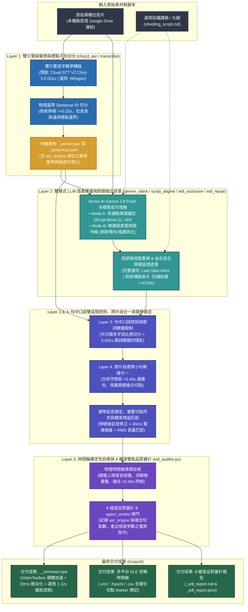

# Video Trimmer (`video-trimmer`)

[](https://github.com/sylphlin/video-trimmer/blob/main/LICENSE)
[](https://www.python.org/)
[]()
[](https://ffmpeg.org/)

[English (en)](README.md) | [繁體中文 (zh-TW)](README.zh-TW.md) | [简体中文 (zh-CN)](README.zh-CN.md) | [日本語 (ja)](README.ja.md) | [한국어 (ko)](README.ko.md)

---

## 專案總覽 (Overview)

**Video Trimmer** 是專為單機位口播、教學影片與演講錄影設計的 AI 自動粗剪引擎。系統結合 **Google Vertex AI Gemini 3.8 Flash** 原生多模態影片理解、**雙引擎毫秒級逐字聲學基準**（預設採用 Google Cloud Speech-to-Text V2 **Chirp 3** `0.001s` 精準度；選用本機 **Whisper** `mlx-whisper` / `faster-whisper`）、**以最後一鏡為基準的跨鏡複合拼接（Last-Take-Anchored Composite Sub-Spans）**、**五層統一剪輯架構（5-Layer Unified Architecture）** 以及 **聲學起音鎖定（Acoustic Onset Snapping）**。每次執行會自動剔除 NG 重錄、句中吃螺絲與無效停頓，並在講者僅補錄後半句時自動往上回補前半句，最後匯出多格式專業剪輯時間軸（`.xml`, `.fcpxml`, `.csv`）、8 維度品質審計報告（`.md`, `.json`）與完成粗剪的 MP4 影片。

---

## 五層統一剪輯架構與核心技術特點



1. **第一層：雙引擎純聲學與標點子句切分 (`chirp3_asr.py` / `transcribe.py`)**：
   - **預設雲端引擎 (`--asr-engine chirp3`)**：採用 Google Cloud Speech-to-Text V2 `chirp_3`（`STT_LOCATION=us`，開啟 `enableWordTimeOffsets=True` 與自動標點），提取 `0.001s` 毫秒級逐字時間戳，內建 18 分鐘音訊自動切塊（含 5 秒重疊視窗）與 `zh-TW` 1 對 1 繁簡字元標準化；若遇雲端權限或認證異常，嚴格執行 Fail-Fast 終止（絕不靜默降級為 Whisper）。
   - **選用本機引擎 (`--asr-engine whisper`)**：當使用者明確指定本機轉錄時，支援 Apple Silicon Metal `mlx-whisper` 或 `faster-whisper`。
   - 僅依據物理邊界切分 `Sentence ID`：換氣停頓（`gap >= 0.20s`，以及中日韓多字詞間自然換氣 `>= 0.35s`）、吃螺絲拉長音起音（`word_dur >= 1.20s` 且單字元 `>= 0.45s`）、句尾標點與說話者輪替，絕不在 Python 端使用字串相似度猜測 NG 重講。
2. **第二層：雙模式 LLM 語意擇優、相鄰短子句自動補齊與閉環微視窗修復 (`gemini_client.py` / `script_aligner.py` / `edl_occlusion.py` / `edl_repair.py`)**：
   - **結構化輸出約束與相鄰短子句自動補齊**：透過 `EDL_RESPONSE_SCHEMA` 強制每個片段對應連續物理 `Sentence ID` 區間，並透過 `_extend_omitted_adjacent_short_clauses`（`edl_occlusion.py`）自動補回模型在 `transcript` 已保留但漏選 `Sentence ID` 的前後短子句。
   - **Mode A：有講稿單調錨定模式（提供拍攝講稿時）**：透過單一真相來源解析器（`script_aligner.py` 中的 `extract_script_blocks`）自動過濾 YAML Frontmatter、鏡位指示與非口播標題欄位，切分為 `[Script Block 01] .. [Script Block NN]`。當講者整句重頭重唸時，100% 維持 `Last-Take-Wins`。
   - **Mode B：無講稿意圖視窗仲裁模式（未提供講稿時）**：剔除未完成殘句重講（Abandoned Fragment），同時保護刻意修辭排比強調。
   - **由右至左跨鏡區間遮罩 (`edl_occlusion.py` 中的 `resolve_composite_prefix_occlusions`)**：當講者僅局部補錄後半段（例如 `Take 1: A + B1 + C_ng`、`Take 2: B2 + C_ok`）時，以最新 `Take 2`（`composite_role="continuation"`）為核心基準，僅從上一鏡 `Take 1` 回補未被覆蓋的前綴 `A`（`composite_role="prefix"`），並強制通過最小獨立子句門檻（`is_viable_sub_span`，時長 `>= 0.55s`）。
   - **對齊後閉環驗證與局部微視窗重掃 (`edl_repair.py`)**：在刪除 GCS 暫存影片前先行驗證物理逐字對齊結果（`asr_transcript`），精準偵測遺漏段落、半句缺漏（`PARTIAL_SCRIPT_BLOCK_BACKFILL`）、講稿子句多重殘留（`SCRIPT_PHRASE_MULTIPLICITY`，支援講稿合法重複白名單）、非講稿廢詞滲漏（`UNSCRIPTED_EXTRANEOUS_SPAN`）、跨片段句尾重講（`TAIL_HEAD_RETAKE`）、單一片段內部重複（`INTRA_CLIP_REPEAT`）與多 Take 衝突（`SCRIPT_TAKE_COLLISION`），僅重掃該 `15s–90s` 局部視訊區間。
3. **第三層：句中口誤雙區間挖除、中日韓字詞比例切分與鄰詞硬牆鉗制 (`transcribe.py`)**：
   - 支援**同句中段吃螺絲挖除**（`_extract_matched_word_spans_by_transcript`），將 `[A + B_ng + B_ok + C]` 自動拆解為 `[A]` 與 `[B_ok + C]` 兩個乾淨子單元。
   - 針對多字詞進行字元比例時間內插（`_slice_words_on_char_span`），並對相鄰未選取廢詞施加 `0.001s` 硬牆鉗制（`next_word_hard_wall` / `prev_word_hard_wall`），防止切入廢詞首音殘影。
4. **第四層：跨片段連貫小句無縫合一 (`coalesce_adjacent_sub_units`)**：
   - 當相鄰片段為連續 `Sentence ID` 且物理字間距 `< 0.40s` 時自動合併為單一連續片段，同時保護跨鏡複合拼接切點（`is_composite_splice`）不被誤合併。
5. **第五層：物理時間軸確定性自癒與 8 維度雙軌品質審計 (`edl_auditor.py`)**：
   - 強制時間軸單調遞增、在鄰詞硬牆上限內保護字尾塞音（`source_out >= t_last`）、縫合 `< 0.45s` 閃幀微碎切，並輸出記錄 `asr_engine`、`1_acoustic_lock`、`composite_splices_count` 與 `agent_verdict` 的 `_edl_report.md` 及 `_edl_report.json`。
6. **聲學起音鎖定、重疊切點同步與響度增益匹配 (`acoustic.py`)**：
   - 自動修正停頓後虛胖的詞首時間戳（`clamp_post_pause_word_onset`）、在複合句重疊詞組中尋找最低 RMS 能量波谷作為無縫切點（`find_optimal_overlap_pivot`）、收緊複合接縫緩衝（`40ms`），並自動補償前後兩鏡的音量落差（`compute_composite_gain_db`，限制於 `±6.0 dB`）。
7. **20 ms 等功率音訊微淡化與選用 1.12x 複合縮放遮瑕 (`render.py`)**：
   - 採用前置 `-ss` / `-to` 關鍵幀快速定位、Apple Silicon `VideoToolbox` 硬體加速（含 `libx264` 備援）、20 ms 等功率微淡化（`iqsin`/`qsin`）、逐片段音量增益匹配，並支援選用 `--punch-in-composite` 對補錄後半段自動套用 `1.12x` 偶數像素裁切放大（Punch-In Zoom）以平滑化視覺跳接。
8. **多平台 NLE 時間軸匯出與複合切點標記 (`exporters.py`)**：
   - 匯出 **Final Cut Pro 7 XML**（`.xml`）、**Apple Final Cut Pro FCPXML v1.9**（`.fcpxml`）與 **CSV** 剪輯表，並在跨鏡複合拼接處自動寫入 `Composite Splice (Pick-up)` 時間軸 `<marker>` 標記與選用 `112%` 縮放參數。

---

## 為何預設採用 Cloud STT V2 Chirp 3 作為聲學基準

口播粗剪與跨鏡複合拼接（Composite Pick-up Splicing）仰賴精準的物理字詞邊界，而非僅供閱讀的字幕級時間軸。**Video Trimmer** 將預設引擎由本機 Whisper 切換為 Google Cloud Speech-to-Text V2 `chirp_3`（`--asr-engine chirp3`），並保留 Whisper（`--asr-engine whisper`）作為離線選用方案，基於以下五項工程原因：

| 評估維度 | Cloud STT V2 `chirp_3`（預設引擎） | 本機 Whisper（`mlx-whisper` / `faster-whisper`，選用） | 對粗剪與跨鏡複合拼接的實質影響 |
| :--- | :--- | :--- | :--- |
| **停頓後詞首邊界精準度** | 直接依據聲學音框輸出 `0.001s`（`1 ms`）逐字時間戳，緊貼真實發聲起點。 | 採用 Cross-Attention DTW 對齊，常將換氣或前段靜音（`0.3s–1.5s+`）併入句首第一個字的 `start` 時間。 | 消除剪輯入點前的無效空白，確保跨鏡補錄 `40ms` 緊湊接縫自然連貫。 |
| **口誤、殘句與重錄保留度** | 忠實保留吃螺絲殘詞與連續重唸片段，且逐字時間戳維持嚴格單調遞增。 | 自迴歸解碼易自動略過短暫口誤、在靜音區產生幻覺迴圈，或在連續重複詞組發生時間戳塌陷（`start == end`）。 | 確保第三層 `next_word_hard_wall` 能精準鎖定未選取廢詞邊界，乾淨挖除句中口誤而不留首音殘影。 |
| **中英夾雜與專有名詞辨識** | 原生支援多語系切換，能單次精準辨識中英混雜的技術詞彙（如 `API`、`SDK`、`GPU`）。 | 輕量本機模型（如 `small`）常將句中英文縮寫誤轉為同音中文字或漏字。 | 大幅提升 Mode A 講稿覆蓋率計算（`_script_block_coverage_score`）與複合重疊詞組對齊準確率。 |
| **原生標點與切句穩定度** | 內建 `enableAutomaticPunctuation=True`，在 18 分鐘長音訊切片中維持一致的子句標點。 | 標點品質受提示詞與背景底噪影響較大，長段落易出現漏標點。 | 提升第一層 `Sentence ID` 物理切句穩定度，避免長句過度黏合或異常碎切。 |
| **本機硬體資源與長片吞吐量** | 僅上傳輕量 16 kHz 單聲道 MP3 切片至雲端平行轉錄，零本機模型權重與記憶體佔用。 | 需下載數百 MB 至數 GB 模型權重，並與 FFmpeg `VideoToolbox` 競爭本機統一記憶體。 | 讓本機 GPU 專注於關鍵幀快速定位與成片渲染；無網路環境仍可切換回 `--asr-engine whisper`。 |

---

## 專案目錄結構（Agent Plugins 1.0 標準規範）

```text
video-trimmer/
├── plugin.json                              # Agent Plugins 1.0 宣告清單
├── rules/
│   └── AGENTS.md                            # 打包於 Plugin 內的客戶端執行期守則（唯讀與 Fail-Fast）
├── skills/
│   └── video-trimmer/                       # 標準技能套件主幹（Single Source of Truth）
│       ├── SKILL.md                         # 技能規範與 Agent 專用 CLI 參數參考手冊
│       ├── scripts/                         # 核心引擎模組實體目錄 (SSOT)
│       │   ├── __init__.py
│       │   ├── video_trimmer.py             # CLI 解析與五層管線協調器
│       │   ├── constants.py                 # 系統常數與 ASR / 複合拼接門檻定義
│       │   ├── exceptions.py                # 例外類別階層
│       │   ├── chirp3_asr.py                # Google Cloud STT V2 Chirp 3 毫秒級逐字轉錄引擎
│       │   ├── acoustic.py                  # 聲學起音鎖定、重疊切點同步與 RMS 響度增益匹配
│       │   ├── transcribe.py                # 雙引擎聲學切句、字詞比例內插與句中口誤挖除
│       │   ├── script_aligner.py            # 講稿區塊解析、文字標準化與講稿覆蓋率計算
│       │   ├── edl_occlusion.py             # 由右至左跨鏡區間遮罩、相鄰短子句補齊與去重排序
│       │   ├── edl_repair.py                # 對齊後閉環異常偵測與局部微視窗重掃修復
│       │   ├── edl_auditor.py               # 物理時間軸單調自癒與 8 維度雙軌品質審計
│       │   ├── gemini_client.py             # Vertex AI (ADC) 客戶端與雙模式提示詞建構
│       │   ├── gcs_utils.py                 # GCS 暫存、Google Drive 快取與中文檔名修復
│       │   ├── exporters.py                 # FCP7 XML、FCPXML v1.9 與 CSV 時間軸匯出（含切點標記）
│       │   └── render.py                    # FFmpeg 微淡化、音量匹配與 1.12x 縮放硬體加速渲染
│       └── prompts/                         # 提示詞規範實體目錄 (SSOT)
│           └── video_cut_prompt.md          # 雙模式語意仲裁與局部補錄複合剪輯規範
├── AGENTS.md                                # 工作區與開發工程規範（Part I 執行守則 & Part II 開發規範）
├── setup.sh                                 # 原生 gcloud 雲端環境一鍵配置腳本
└── tests/                                   # 離線單元測試套件（152 項測試）
```

---

## 安裝與 Google Cloud 環境設定

### 1. 安裝 FFmpeg

```bash
# macOS (Homebrew)
brew install ffmpeg

# Ubuntu / Debian
sudo apt update && sudo apt install -y ffmpeg
```

### 2. 安裝為 Antigravity Plugin

```bash
# 全域 Antigravity Plugin（建議）
git clone https://github.com/sylphlin/video-trimmer.git ~/.gemini/config/plugins/video-trimmer

# 舊版獨立 Skill 目錄安裝（~/.gemini/config/skills/ 相容方式）
ln -s ~/.gemini/config/plugins/video-trimmer/skills/video-trimmer ~/.gemini/config/skills/video-trimmer

# 安裝核心 Python 相依套件（預設使用雲端 Chirp 3 + Vertex AI）
pip install -r ~/.gemini/config/plugins/video-trimmer/requirements.txt

# 選用：安裝本機 Whisper 轉錄套件（Apple Silicon Metal，供 --asr-engine whisper 使用）
pip install mlx-whisper
```

### 3. 一鍵配置 Google Cloud 資源 (`./setup.sh`)

執行 `setup.sh` 自動啟用 Vertex AI、Cloud Speech-to-Text V2（`chirp_3`）與 Cloud Storage，並寫入 `.env` 設定：

```bash
gcloud auth application-default login
cd ~/.gemini/config/plugins/video-trimmer
chmod +x setup.sh
./setup.sh --project YOUR_GCP_PROJECT_ID --region us-central1
```

---

## Antigravity 操作方式與使用情境 (Usage & Scenarios)

在 Antigravity 中，您可以透過以下兩種方式操作 **Video Trimmer**：

1. **極簡指令（`/` 指定技能 + `@` 標記檔案，推薦）**：輸入 `/video-trimmer` 選取技能，並用 `@` 標記影片與講稿檔案，僅需列出關鍵欄位（如 `影片: @XX, 講稿: @YY`），無須撰寫完整句子。
2. **口語表達（自然語言自動觸發）**：直接用日常口語描述剪輯需求，Antigravity 會自動識別意圖並呼叫此 Plugin。

系統預設採用雲端 **Chirp 3** 轉錄引擎（`--asr-engine chirp3`），所有產出檔案皆會自動隔離儲存於原始影片目錄下的 `output/` 子目錄（Google Drive 連結則為 `./output/`）。若需使用本機離線聲學轉錄可指定 `ASR: whisper`；若需在跨鏡補錄切點自動微幅放大畫面遮瑕，可指定 `縮放遮瑕: 開啟`（`--punch-in-composite`）。

### 情境 1：有講稿 / 大綱的錄影粗剪（Mode A：講稿錨定對齊）
適用於已備妥拍攝腳本或口播大綱的錄影。系統會自動過濾非口播標題，在講者整句重唸時保留最後一鏡（`Last-Take-Wins`），並在講者僅補錄後半句時自動回補上一鏡的前半句。

- **極簡指令**：
  ```text
  /video-trimmer 影片: @raw_footage.mp4, 講稿: @shooting_script.md
  ```
- **口語表達**：
  ```text
  幫我照著 @shooting_script.md 修剪 @raw_footage.mp4，剪掉吃螺絲和重錄片段。
  ```

### 情境 2：無講稿的即興口播、訪談或 Vlog 粗剪（Mode B：無稿智慧去重）
適用於無腳本的自由發揮錄影，系統會自動剔除說到一半放棄重講的殘句、句中口誤與空白停頓，同時保留刻意排比強調的語句。

- **極簡指令**：
  ```text
  /video-trimmer 影片: @raw_footage.mp4
  ```
- **口語表達**：
  ```text
  請幫我把 @raw_footage.mp4 裡面的口誤、卡詞跟重複開頭剪掉，匯出剪輯時間軸與粗剪影片。
  ```

### 情境 3：快節奏教學或短影音粗剪（緊湊節奏模式）
適用於需要縮短句間換氣停頓的高密度教學或解說影片。

- **極簡指令**：
  ```text
  /video-trimmer 影片: @raw_footage.mp4, 講稿: @shooting_script.md, 節奏: 緊湊
  ```
- **口語表達**：
  ```text
  請用緊湊節奏幫我粗剪 @raw_footage.mp4，並對照 @shooting_script.md 去除重講片段。
  ```

### 情境 4：Google Drive 雲端影片直接粗剪
無須手動下載大檔案，直接提供 Google Drive 分享連結即可自動完成下載快取、聲學對齊與雲端粗剪。

- **極簡指令**：
  ```text
  /video-trimmer 影片: https://drive.google.com/file/d/YOUR_FILE_ID/view, 講稿: @shooting_script.md
  ```
- **口語表達**：
  ```text
  幫我下載這個 Google Drive 連結的影片並對照 @shooting_script.md 完成粗剪：https://drive.google.com/file/d/YOUR_FILE_ID/view
  ```

---

## 自動交付成果 (Generated Deliverables)

每次執行完成後，Agent 會在 `output/` 目錄下產出並驗證以下檔案：

1. **`<basename>_<tag>_trimmed.mp4`**：套用 20 ms 等功率音訊微淡化與跨鏡響度匹配、可直接播放的粗剪成品影片。
2. **`<basename>_<tag>_edl.xml`**：適用於 **Adobe Premiere Pro** 與 **DaVinci Resolve** 的 Final Cut Pro 7 XML 時間軸（含 `Composite Splice` 標記）。
3. **`<basename>_<tag>_edl.fcpxml`**：適用於 **Apple Final Cut Pro** 的 FCPXML v1.9 時間軸（含 `Composite Splice` 標記）。
4. **`<basename>_<tag>_edl.json`** / **`<basename>_<tag>_edl.csv`**：結構化剪輯決策資料與試算表剪輯清單。
5. **`<basename>_<tag>_edl_report.md`** / **`.json`**：8 維度粗剪品質審計報告（含 `asr_engine`、`1_acoustic_lock`、`composite_splices_count` 與 `agent_verdict` 品質閘門結果）。
6. **`<basename>_words.json`** 與 **`<basename>_sentences.json`**：標記轉錄引擎（`chirp3` 或 `whisper`）之毫秒級逐字聲學快取與子句切分 `Sentence ID` 候選索引。

---

## Google Drive 分享連結與 GCS 雙層生命週期規則

| GCS 路徑前綴 (`matchesPrefix`) | 儲存內容 | 保留天數 (`age`) | 規則說明 |
| :--- | :--- | :--- | :--- |
| **`raw/`** | 暫存原始影片 (`raw/<filename>.mp4`) 與 Chirp 3 音訊切片 (`raw/chirp3_asr_*/`) | **2 天 (`age: 2`)** | 推論與轉錄完成後於 `finally` 區塊立即刪除，並以 2 天自動刪除規則作為安全備援。 |
| **`output/`**、**`deliverables/`**、**`trimmed/`** | 粗剪影片、XML/FCPXML 時間軸與 EDL 報告 | **15 天 (`age: 15`)** | 保留 15 天供團隊審閱與下載，期滿自動清理。 |

---

## 單元測試 (Unit Testing)

提交變更前請執行完整離線單元測試套件（152 項測試）：

```bash
python3 -m unittest discover -s tests -v
```

---

## 授權條款 (License)

本專案採用 [MIT License](LICENSE) 授權。
